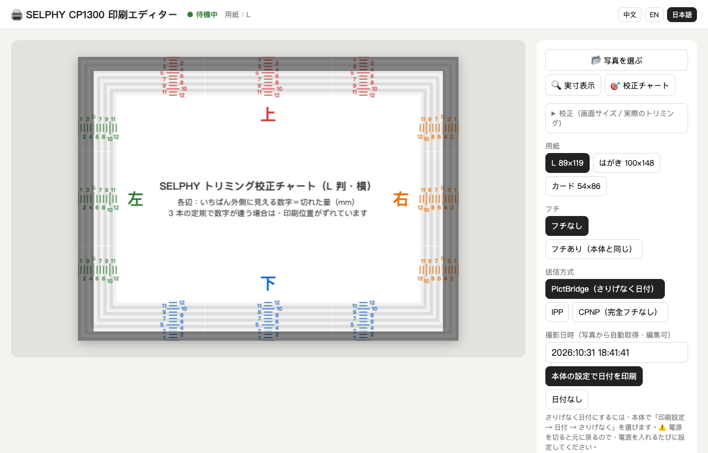

# selphy-pictbridge

[English](README.md) · [繁體中文](README.zh-TW.md) · **日本語**

Mac から Wi-Fi 経由で **Canon SELPHY CP1300** に印刷するツールです。ブラウザ上の簡単な編集画面（トリミング、拡大縮小、回転、実寸プレビュー）付きで、**本体の「日付 さりげなく」も印刷できます**。日付が透明なオーバーコート層に入るので、正面からは見えず、写真を傾けて光に当てたときだけ浮かび上がります。

この「さりげなく」日付は、これまでカメラからの直接印刷か、本体にメモリーカードを挿して印刷したときしか使えませんでした。AirPrint（IPP）や、Canon 純正アプリが使う CPNP プロトコルでは反映されません（2026-11-01 実機確認）。本プロジェクトでは、Mac が Wi-Fi 上で **PictBridge 対応カメラのふりをする**（DPS over PTP-IP）ことでこれを実現しています。

> 本プロジェクトは Canon Inc. とは無関係であり、同社による承認・後援は受けていません。「Canon」「SELPHY」は Canon Inc. の商標です。



## 仕組み

| 送信方式 | ファイル | さりげなく日付 | 備考 |
|---|---|---|---|
| **PictBridge**（既定） | `pictbridge_cam.py` | ✅ | Mac が TCP 15740 で PTP-IP レスポンダ（＝カメラ）として待ち受け、プリンターの UPnP `DPSConnectionManager` に `ConnectionRequest` を送信。プリンター側から接続し直して JPEG を取得します |
| IPP／AirPrint | `server.py`＋`ipptool` | ❌ | 最も安定。用紙を使わない「検証のみ」に対応 |
| CPNP | `cpnp.py` | ❌ | Canon アプリのプロトコル（UDP/TCP 8609）。CP1300 は CP900 世代の 64 バイトの開始コマンドしか受け付けません |

PictBridge では `datePrint` を「標準設定」（`54000000`）として送ります。これはプリンター本体の日付設定に従うという意味です。本体側を「**さりげなく**」にしておけば、日付がオーバーコート層に入ります。

## 主な機能

- ドラッグで位置調整、拡大縮小、回転、縦／横、三分割グリッド、白フチ追加
- **実寸プレビュー**：画面上に L 判を実寸で表示し、プリントを重ねて比較できます（定規で一度だけ画面を校正）
- **実測トリミング表示**：PictBridge のフチなし印刷は約 108% に拡大されます（手元の CP1300 の実測値：上 4.5 mm、下 3 mm、左右 各 5 mm〈左右はミシン目まで〉）。切れる部分をプレビュー上で暗く表示します。「🎯 校正チャート」でお使いの機体を測定できます
- JPEG の EXIF から撮影日時を自動取得し、プリンターに送る JPEG にも書き込みます
- プリンターの状態をリアルタイム表示。SELPHY のネットワーク機能は同時に 1 接続しか扱えないため、通信はすべて順番待ちにしています
- 画面は日本語・英語・繁体字中国語に対応。ブラウザの言語で自動選択され、右上で切り替えられます

## 動作環境

- macOS（標準の `ipptool`、`ippfind`、`sips` を使用）、Python 3.10 以上（外部パッケージ不要）
- Mac と同じ Wi-Fi に接続した Canon SELPHY CP1300。ファームウェア 1.00、L 判用紙で動作確認
- iPhone の HEIC をそのまま開けるので、Safari を推奨します

## 設定

`.env` は不要です。任意の環境変数：

- `SELPHY_URI`：プリンターの IPP アドレス（例：`ipp://192.168.1.50:631/ipp/print`）。PictBridge と CPNP も同じホストを使います。未設定の場合、起動時に「SELPHY」という名前のプリンターを自動で探します
- `SELPHY_PORT`：編集画面のポート番号（既定値 `8765`）

コードを変えずにプリンターのアドレスを固定したい場合は、起動ファイルと同じ場所に `selphy.local.conf`（git 管理対象外）を作成します：

```sh
export SELPHY_URI=ipp://192.168.1.50:631/ipp/print
```

プリンター側：

1. **Wi-Fi (( ))** ボタンを押し、接続完了の画面のままにしておきます。ネットワーク印刷はこの状態でのみ使えます
2. さりげなく日付を使う場合：**印刷設定 → 日付 → さりげなく**。⚠️ **電源を切るとこの設定は元に戻ります**
3. 印刷中に用紙が本体の後ろから何度も出入りするので、後方に 10 cm ほど空けてください。給紙されない・紙詰まりする場合は、給紙ローラーをイソプロピルアルコールで拭くと改善することがあります

## 使い方

`start.command` をダブルクリックする（Safari で http://127.0.0.1:8765 が開きます）か、次を実行します：

```sh
python3 server.py
```

編集画面を使わずにコマンドで印刷する場合：

```sh
python3 pictbridge_cam.py <プリンターIP> --probe                          # PictBridge の対応機能を確認（印刷しない）
python3 pictbridge_cam.py <プリンターIP> --print photo.jpg --dateprint default
python3 cpnp.py <プリンターIP> --handshake                                # CPNP のハンドシェイク（印刷しない）
```

## テスト

```sh
python3 test_server.py                    # 単体テスト
SELPHY_LIVE=1 python3 test_server.py      # 実機への IPP Validate-Job も実行（用紙は使いません）
```

## プロトコルメモ（公開資料が見つからず、実機で確認したこと）

- プリンターは SSDP で `urn:schemas-cipa-jp:device:DPSPrinter:1` を告知します。内蔵の NetX HTTP サーバーは、一般的な HTTP ライブラリが送る SOAP リクエストを中断（`500`）します。CRLF 改行・大文字のヘッダー名・`HOST: <ip>:80` を使った生のリクエストなら受け付けられます
- `ConnectionRequest` を送る**前に** TCP 15740 で待ち受けを始めてください。順序が逆だと、プリンターは受け付けたあとカメラが見つからず、電源を入れ直すまで `BUSY` を返し続けます
- DPS のディスカバリーは、プリンターが `HDISCVRY.DPS` の `SendObjectInfo` を送った時点で完了します（`SendObject` は続きません）。ファイル名はプリンター視点の命名で、`D*` はカメラが書くファイル（`DREQUEST`、`DRSPONSE`）、`H*` はプリンターが書くファイル（`HREQUEST`、`HRSPONSE`）です
- CP1300 の `getCapability` は `datePrints = 54000000 54010000 54020000`（標準設定／切／入）を返します。Canon 独自の「さりげなく」の値はなく、「標準設定」で本体の設定に従います
- CPNP 経由では、CP1300 はホストにオーバーコートデータを要求しません。そのため CP1500 で使える、ホスト側からのオーバーコート模様指定は CP1300 では使えません

## クレジット

- CIPA DC-001／DC-005（PictBridge、DPS over IP）、[Eclipse ThreadX USBX](https://github.com/eclipse-threadx/usbx) の `ux_pictbridge`（DPS のファイル名と XML タグ）
- [tlambertz/selphy-print](https://github.com/tlambertz/selphy-print)（CPNP、MIT。`cpnp.py` はその移植）、selphy_go（CP900 の CPNP）、gutenprint `backend_canonselphyneo.c`

## ライセンス

MIT。[LICENSE](LICENSE) を参照してください（`cpnp.py` のサードパーティーライセンス表記を含みます）。
