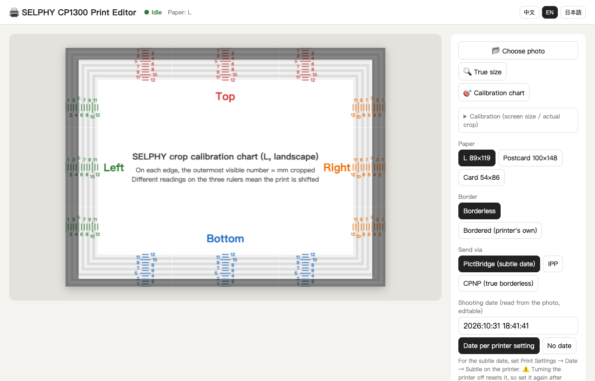

# selphy-pictbridge

**English** · [繁體中文](README.zh-TW.md) · [日本語](README.ja.md)

Print to a **Canon SELPHY CP1300** over Wi-Fi from a Mac, with a small browser editor (crop, zoom, rotate, true-size preview), and **get the printer's "subtle" date stamp**: the invisible date in the clear overcoat that only shows up when you tilt the print towards the light.

Until now that subtle date was only available when printing from a camera or from an SD card inserted in the printer. AirPrint (IPP) and Canon's own CPNP app protocol do not apply it (tested 2026-11-01). This project gets it by making the Mac **pretend to be a PictBridge camera** over Wi-Fi (DPS over PTP-IP).

> Not affiliated with, endorsed by, or sponsored by Canon Inc. "Canon" and "SELPHY" are trademarks of Canon Inc.



## How it works

| Transport | File | Subtle date | Notes |
|---|---|---|---|
| **PictBridge** (default) | `pictbridge_cam.py` | ✅ | The Mac listens on TCP 15740 as a PTP-IP responder ("camera") and calls `ConnectionRequest` on the printer's UPnP `DPSConnectionManager`; the printer then connects back and pulls the JPEG |
| IPP / AirPrint | `server.py` + `ipptool` | ❌ | Most robust; supports a paper-free "validate only" |
| CPNP | `cpnp.py` | ❌ | Canon's app protocol (UDP/TCP 8609). The CP1300 only accepts the CP900-era 64-byte start command |

With PictBridge, `datePrint` is sent as *default* (`54000000`), which tells the printer to use its own date setting. Set that to **Subtle** on the printer and the date ends up in the overcoat.

## Features

- Drag to position, zoom, rotate, portrait/landscape, rule-of-thirds grid, extra white border
- **True-size preview**: show the photo at real L size on screen (one-time ruler calibration)
- **Measured crop mask**: borderless PictBridge prints are scaled by about 108% (on our CP1300: top 4.5 mm, bottom 3 mm, left and right 5 mm to the perforation). The preview darkens what will be cut. Use **🎯 Calibration chart** to measure your own printer
- Shooting date read automatically from the JPEG EXIF and written back into the JPEG sent to the printer
- Live printer status; all printer traffic is serialized (the SELPHY's network stack handles one connection at a time)
- Interface in English, Traditional Chinese and Japanese, picked from the browser language (switch top-right)

## Requirements

- macOS (uses the built-in `ipptool`, `ippfind` and `sips`); Python 3.10+ with no third-party packages
- Canon SELPHY CP1300 on the same Wi-Fi network as the Mac. Tested with CP1300 firmware 1.00, L size paper
- Safari is recommended, since it can open iPhone HEIC files directly

## Setup

No `.env` needed. Optional environment variables:

- `SELPHY_URI`: the printer's IPP address, e.g. `ipp://192.168.1.50:631/ipp/print`. PictBridge and CPNP use the same host. If not set, the server searches for a printer named "SELPHY" at startup
- `SELPHY_PORT`: editor port, default `8765`

To pin a printer address without touching the code, create `selphy.local.conf` (git-ignored) next to the launcher:

```sh
export SELPHY_URI=ipp://192.168.1.50:631/ipp/print
```

On the printer:

1. Press the **Wi-Fi (( ))** button and stay on the "connected" screen. Network printing only works in this mode
2. For the subtle date: **Print Settings → Date → Subtle**. ⚠️ Turning the printer off resets this setting
3. Keep about 10 cm free behind the printer, since the paper moves out the back several times. If paper doesn't feed, clean the feed rollers with isopropyl alcohol

## Usage

Double-click `start.command` (it opens http://127.0.0.1:8765 in Safari), or run:

```sh
python3 server.py
```

Command line, without the editor:

```sh
python3 pictbridge_cam.py <printer-ip> --probe                          # PictBridge capabilities, no printing
python3 pictbridge_cam.py <printer-ip> --print photo.jpg --dateprint default
python3 cpnp.py <printer-ip> --handshake                                # CPNP handshake, no printing
```

## Tests

```sh
python3 test_server.py                    # unit tests
SELPHY_LIVE=1 python3 test_server.py      # plus a paper-free IPP Validate-Job against the real printer
```

## Protocol notes (things that were not documented anywhere we could find)

- The printer advertises `urn:schemas-cipa-jp:device:DPSPrinter:1` over SSDP. Its NetX HTTP server aborts (`500`) SOAP requests sent by typical HTTP libraries; a raw request with CRLF line endings, upper-case header names and `HOST: <ip>:80` is accepted
- Start listening on TCP 15740 **before** sending `ConnectionRequest`. Otherwise the printer accepts, finds no camera, and then answers `BUSY` until it is power-cycled
- DPS discovery completes on the `SendObjectInfo` of `HDISCVRY.DPS` (no `SendObject` follows). File names are from the printer's point of view: `D*` files are written by the camera (`DREQUEST`, `DRSPONSE`) and `H*` files by the printer (`HREQUEST`, `HRSPONSE`)
- `getCapability` on the CP1300 reports `datePrints = 54000000 54010000 54020000` (default/off/on). There is no Canon-specific "subtle" value; *default* defers to the printer's setting
- Over CPNP the CP1300 never requests overcoat data, so host-supplied overcoat patterns (which the CP1500 supports) are not available

## Credits

- CIPA DC-001 / DC-005 (PictBridge, DPS over IP); [Eclipse ThreadX USBX](https://github.com/eclipse-threadx/usbx) `ux_pictbridge` for DPS file names and XML tags
- [tlambertz/selphy-print](https://github.com/tlambertz/selphy-print) (CPNP, MIT; `cpnp.py` is a port), selphy_go (CP900 CPNP), gutenprint `backend_canonselphyneo.c`

## License

MIT. See [LICENSE](LICENSE), which includes the third-party notice for `cpnp.py`.
