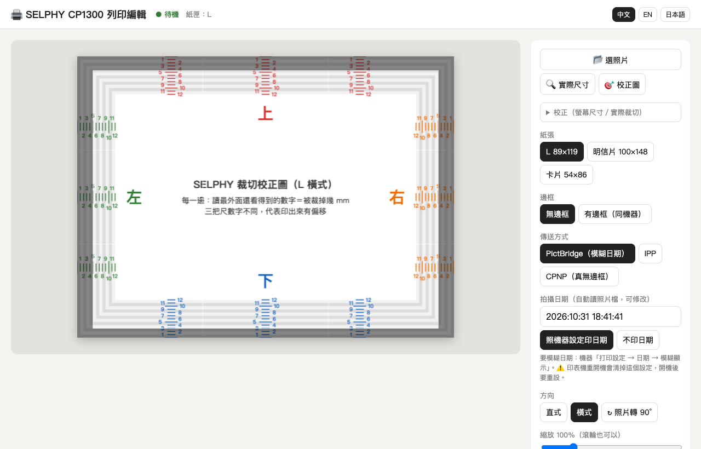

# selphy-pictbridge

[English](README.md) · **繁體中文** · [日本語](README.ja.md)

在 Mac 上透過 Wi-Fi 列印到 **Canon SELPHY CP1300**，附一個瀏覽器編輯器（裁切、縮放、旋轉、實際尺寸預覽）。而且**能印出機器的「模糊日期」**：日期做在透明保護膜上，正面看不到，照片斜著對燈光才看得到。

這個模糊日期原本只有相機直印，或插 SD 卡在機器上印才有。AirPrint（IPP）和 Canon 自家 App 用的 CPNP 協定都不會套用（2026-11-01 實測）。本專案的做法是讓 Mac 透過 Wi-Fi **假扮成 PictBridge 相機**（DPS over PTP-IP）。

> 本專案與 Canon Inc. 無關，未獲其背書或贊助。「Canon」與「SELPHY」為 Canon Inc. 的商標。



## 運作方式

| 傳送方式 | 檔案 | 模糊日期 | 說明 |
|---|---|---|---|
| **PictBridge**（預設） | `pictbridge_cam.py` | ✅ | Mac 開 TCP 15740 扮成相機（PTP-IP 回應端），對印表機的 UPnP `DPSConnectionManager` 送 `ConnectionRequest`；印表機反過來連進來讀照片 |
| IPP／AirPrint | `server.py`＋`ipptool` | ❌ | 最穩；有「只驗證、不出紙」 |
| CPNP | `cpnp.py` | ❌ | Canon App 的協定（UDP/TCP 8609）；CP1300 只吃 CP900 世代的 64 bytes 開始指令 |

PictBridge 送出的 `datePrint` 是「預設」（`54000000`），意思是照印表機本身的日期設定印。機器上設成「**模糊顯示**」，日期就會做在保護膜上。

## 功能

- 拖曳移位、縮放、旋轉、直式／橫式、九宮格、另外加白框
- **實際尺寸預覽**：在螢幕上用真實的 L 尺寸顯示，拿相紙直接貼上去比對（需要用尺校正一次）
- **實測裁切遮罩**：PictBridge 無邊框會放大約 108%（我們的 CP1300 實測：上 4.5、下 3、左右各 5 mm，左右算到撕線）。預覽會用暗色遮住會被裁掉的部分。用「🎯 校正圖」可以量你自己的機器
- 自動讀 JPEG EXIF 的拍攝日期，並寫回送給印表機的照片
- 即時顯示印表機狀態；所有送給印表機的請求都排隊，因為 SELPHY 一次只吃得下一條連線
- 介面有繁中、英文、日文，依瀏覽器語言自動選擇（右上角可切換）

## 需求

- macOS（使用內建的 `ipptool`、`ippfind`、`sips`）；Python 3.10 以上，不需要第三方套件
- Canon SELPHY CP1300，跟 Mac 在同一個 Wi-Fi。實測韌體 1.00、L 尺寸相紙
- 建議用 Safari，可以直接開 iPhone 的 HEIC

## 設定

不需要 `.env`。可選的環境變數：

- `SELPHY_URI`：印表機的 IPP 位址，例如 `ipp://192.168.1.50:631/ipp/print`。PictBridge 和 CPNP 也用同一個主機。沒設定的話，啟動時會自動搜尋名稱含「SELPHY」的印表機
- `SELPHY_PORT`：編輯器的埠號，預設 `8765`

想固定印表機位址又不改程式，可以在啟動檔旁邊建一個 `selphy.local.conf`（不會進 git）：

```sh
export SELPHY_URI=ipp://192.168.1.50:631/ipp/print
```

印表機端：

1. 按 **Wi-Fi (( ))** 鍵，停在連線畫面。網路列印只在這個模式下有效
2. 要模糊日期：**打印設定 → 日期 → 模糊顯示**。⚠️ **重開機會清掉這個設定**
3. 機器後方留約 10 公分，列印時紙會從後面進出好幾次。不進紙或卡紙，先用異丙醇擦進紙滾輪

## 使用

雙擊 `start.command`（會用 Safari 開 http://127.0.0.1:8765），或執行：

```sh
python3 server.py
```

不開編輯器、直接用指令：

```sh
python3 pictbridge_cam.py <印表機IP> --probe                          # 探測 PictBridge 能力，不出紙
python3 pictbridge_cam.py <印表機IP> --print photo.jpg --dateprint default
python3 cpnp.py <印表機IP> --handshake                                # CPNP 握手，不出紙
```

## 測試

```sh
python3 test_server.py                    # 單元測試
SELPHY_LIVE=1 python3 test_server.py      # 加跑真機 IPP Validate-Job（不出紙）
```

## 協定筆記（查不到公開資料、實測才知道的事）

- 印表機用 SSDP 廣播 `urn:schemas-cipa-jp:device:DPSPrinter:1`。它的 NetX HTTP 伺服器會直接中止（`500`）一般 HTTP 函式庫送出的 SOAP 請求；要用原始格式：CRLF 換行、大寫標頭、`HOST: <ip>:80`
- 一定要**先**在 TCP 15740 開好等待，**再**送 `ConnectionRequest`。不然印表機接受後找不到相機，之後會一直回 `BUSY`，要重開機才恢復
- DPS 探索在印表機送出 `HDISCVRY.DPS` 的 `SendObjectInfo` 時就完成，不會再有 `SendObject`。檔名是從印表機角度命名：`D*` 是相機寫的（`DREQUEST`、`DRSPONSE`），`H*` 是印表機寫的（`HREQUEST`、`HRSPONSE`）
- CP1300 的 `getCapability` 回報 `datePrints = 54000000 54010000 54020000`（預設／關／開），沒有 Canon 自訂的「模糊」代碼；「預設」就是交給機器的設定
- 走 CPNP 時，CP1300 從來不會跟主機要保護膜資料，所以 CP1500 才有的「主機自訂保護膜圖案」在 CP1300 上用不了

## 致謝

- CIPA DC-001／DC-005（PictBridge、DPS over IP）；[Eclipse ThreadX USBX](https://github.com/eclipse-threadx/usbx) 的 `ux_pictbridge`（DPS 檔名與 XML 標籤）
- [tlambertz/selphy-print](https://github.com/tlambertz/selphy-print)（CPNP，MIT；`cpnp.py` 移植自它）、selphy_go（CP900 的 CPNP）、gutenprint `backend_canonselphyneo.c`

## 授權

MIT，詳見 [LICENSE](LICENSE)（內含 `cpnp.py` 的第三方授權聲明）。
